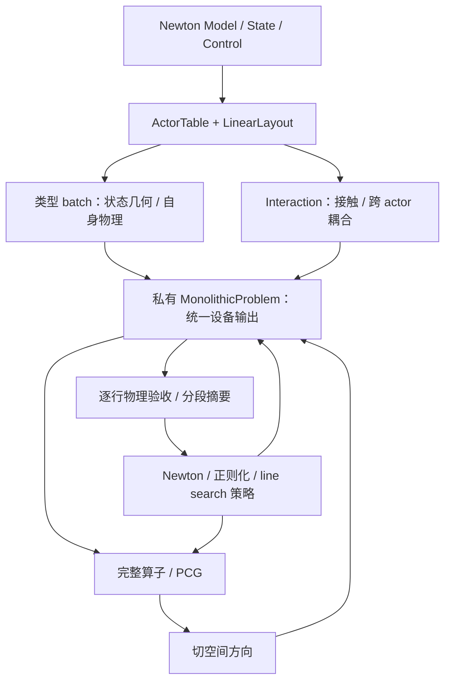

# PR-01：以 actor 为自由度所有者的统一非线性求解接口

2026-11-02。状态：**IN_PROGRESS**。起点 `8fa80ba7`；这是用户指定的首个实现 PR。需求以 [PRD](PRD.md) 为准，参考来源见 [references](references.md)。

## 1. 交付物与边界

交付一个私有 `_MonolithicProblem` 和一份设备执行计划，供唯一的 Newton/line-search 策略使用。ActorTable 决定状态与自由度归属；类型 batch 实现状态几何和自身物理；contact/interaction 添加耦合；线性层仍解完整系统。

最终覆盖当前支持的 articulation、rigid、tet、cloth、cable 与 contact 组合。不得保留“q+x 专用设备实现 + 通用 NumPy fallback”。无 tet、无 articulation、不同 actor 排列都是正常输入，缺失必需能力应显式报错。

本 PR 完成 M2/M3/M4、L4/L5 的必要设备迁移，以及 M5 的迭代内回读移除。H2 的稀疏布局哈希、M1 的进一步小 packet 融合、M5 最终诊断快照和 L1/L2/L3 的额外缓存优化分别记录，不把它们伪装成 H1 已消除的成本。

## 2. 数据流

策略看不到 actor 类型或 q/x 边界；几何操作不会被移到通用归约 kernel。actor ownership、物理贡献、预条件器块、两套收敛组和 world/island 域各有独立描述。

## 3. 内部里程碑

### 01A：冻结基线、贡献清单与 red tests

- 盘点每个 producer 的状态、E/r/B、absolute、domain、reaction、history 和 matrix-free 输出；标出 host 运算及生命周期。保存起点版本、配置、输入、已有门槛和 kernel/同步计数。
- 从已有 q+x、多树、rigid、material fixtures 建立最小可重复比较；不另跑完整机器人轨迹作调试基线。
- 加入针对行为的失败用例：混合组设备归约、缺少必需贡献/phase 拒绝、遗漏 rigid energy、非 q+x 实际位移、热路径完整向量回读、材料 trial 污染。不能仅断言类名存在或旧私有字段删除。
- 对数学上本来就正确的行为用独立 oracle 固定保护，不强求所有重构测试在旧版失败；明确哪些是新合同 red tests。

验收：requirements-to-test 表和基线收据完整，旧版的预期失败已解释；尚不标记 H1 修复。

### 01B：ownership 派生计划与最薄 problem

- 从 ActorTable/LinearLayout 生成唯一 owner map、typed batch offsets、线性组和物理 RowGroups；复用 `group_data` 编号语义，不再 `1+row_group`。
- 为连续与离散物理组建立 chunk/segment 归约计划；每行每项只访问有限次。空 group 的 sum=0/min=+inf 等中性值不能被当成有效失败或错误收敛，零自由度整体场景沿用现有拒绝/支持合同。
- 以当前 producer 为基础拆分 enqueue 与 collect，统一写入 outputs；初始化验证必需 phase 和每项贡献注册。引入 `_MonolithicProblem` 接口并让 iteration 调用它。
- 同一份问题定义供 CPU/CUDA、graph-off/on 使用；单树 q+x 先通过独立 E/r/B 和物理标准验证。

验收：分组与 snapshot/reduction 组件通过；阶段性迁移兼容可保留，但不作为最终入口。

### 01C：多树、刚体与无 tet 全链路

- energy registry 包含全部 rigid energy 和 absolute-energy，contact 只登记一次；无某类 actor 的 batch 安全为空。
- articulation/粒子 difference 读取配套 step increments；rigid 实现 COM 和左乘相对旋转 log。使用显式 row maps，不从 `i<nq` 猜类型。
- domain 写统一 flags，包括旋转边界；保留现有 epsilon/坐标尺度、刚体步长统计约定，不能一律除以 scale。
- 打通 accepted linearize → PCG direction → candidate → domain/E/r/difference → decision → accept/reject → publish；交叉接触块和投影完整。

验收：单树+tet、多树混合单位、多树+rigid+tet 接触、rigid-only/joint-only/tet-only、actor 排列、旋转边界和 rejected trial；移除 single-tree/no-rigid/has-tet 门槛但不绕过能力验证。

### 01D：cloth/cable 完整设备契约

- 拆分材料 block 中的设备提交和 host 收集；整条路径检查、frame/history 更新、固定行反力、控制冻结/finite 校验全部写预分配输出。
- gauge 的 Jacobian 零模判断、因子分段检查、净 torque 兼容性和 delta 投影迁设备；保留原严格比较与精度，不以新阈值掩盖归约变化。
- 接入 cable BSR + matrix-free product/absolute product；trial `build_tangent=False` 不能覆盖 accepted element matrices。
- 接触作用后的 raw reaction、theta torque 与最后输出 generation 统一；不以 free rows 的 residual 代替固定点反力。
- 构建/捕获可以逐 block 展开，稳态按类型/phase 提交 graph，不能在每次迭代中逐 block `.numpy()`。CPU/graph-off 也运行同一批提交逻辑。

验收：材料控制错误、fixed/gauge、空因子、接触 torque、路径越界、rejected trial/operator 保留、checkpoint continuation/失败回滚；两精度与有/无 graph。至此才满足 H1 的全类型覆盖。

### 01E：唯一入口、删除旧路径、PR 收尾

- 删除旧 `_evaluate_eager` 与硬编码 q+x evaluation 组合分支、`_device_iteration` 选择器及迭代中的 NumPy RHS/norm/dot/displacement；方法名可合并重用，但不可留下隐藏 fallback。
- 删除被新路径替代的物理实现、临时开关、scratch 和失效测试假设；保留独立数学 oracle、failure rollback、受支持 checkpoint/API 兼容测试。
- iteration 中不读取 material/rigid/tet-specific 字段，也不硬编码 global/q/x 名称；限值、posterior、step statistics 由 metadata/summary 提供。
- 最终残差诊断暂在发布边界按 M5 原接口保存，标注其字节；H2 哈希单列，仍需完整计入端到端成本。
- 执行 64 步混合 E2E、回读/存储增长审计、小 q+x、FP64/FP32 quick、pre-commit，更新指南与所需 changelog，再提交本 PR 的完成记录。

验收：所有合同项有结果，旧路径彻底删除；只有包装层而材料仍走 NumPy时判为未完成。

## 4. 文件责任与测试映射

| 文件/模块 | 计划职责 | 主要现有测试 |
| --- | --- | --- |
| `actors.py`、`linear_types.py`、`convergence.py`、`pcg_common.py` | ownership 派生与两套 group；尽量不改变现有公共表示 | solver_actor_layout、solver_convergence、linear_multitree |
| 新 `problem.py`、`producers.py` | 私有协调、贡献注册、typed phase；复用现有物理 kernel | solver_producers、solver_contracts；新增 solver_problem 功能测试 |
| `iteration.py`、`iteration_device.py` | 类型无关策略与通用分段归约；文件可收敛，避免再造第三条实现 | solver_reductions、solver_direction、solver_globalization、precision_oracle |
| `solver_monolithic.py` | 公共入口与事务适配；替换旧双路调度 | solver_coupled、multitree、state_api、publication、input_boundary、graph |
| `rigid.py`、材料 block/operator、contact producer 必要部分 | domain/difference/energy、path/gauge/reaction/control 的设备输出 | solver_rigid、actor_contacts、cable_operator/solver/linear、cloth_solver/linear、material_state |

测试实际名称以仓库 `test_monolithic_*.py` 为准，新增测试按功能命名。不要大规模重命名无关模块或测试。

## 5. 测量合同与退出检查

以固定 actor 数 1/2/4/8 的同类型扩展和代表性混合场景，固定 Newton/PCG/trial 工作量记录：

- 非线性完整行向量 D2H 为 0（明确排除单列的 H2 布局与最终 Stats）；无逐 actor host 同步。
- 两套 group 正确，scratch 随 N/chunks/groups 线性增长，不出现 G×N。
- 所有已启用物理贡献覆盖；接触恰好计一次；rigid energy、固定反力、cable element operator 均可独立核对。
- 64 步真实输入→state_out/Stats E2E 与 failure branches；图内不能分配项目长期 buffer。初始化和库内部临时 scratch 按既有所有权规则区分。
- PR 收尾的实际 source/import/config/input hashes 与结果绑定。无新的硬失败或 frozen gate 回退；Stopped/Converged 分开报告。

结构计数是硬目标，运行速度先测后报告；当前没有承诺未经测量的百分比。每个里程碑完成只写局部结果，01E 前不能把 PR-01 标为完成。

## 6. 实现记录

2026-11-02，01A/01B 的分组归约基础：

- `test_layout_group_norms` 在旧实现上按预期失败：混合 articulation/rigid/tet/cloth/cable 布局需要 10 组，设备结果只有 3 组。
- 新 `SegmentedReduction` 使用固定次序的 chunk/segment 两级归约；支持离散行、空组、NaN 传播。线性组使用 global 加不重叠分区，共 2N 个行索引，没有 G×N scratch。
- `test_monolithic_solver_reductions` CPU/CUDA 共 10 项通过，包含 FP32/FP64、CUDA graph 捕获和修改输入后的重放。该结果只证明归约基础；旧双路径和材料 host 收集尚未移除。
- 原始结果目录为工作区 `dev/monolithic/test/results/P9/P9a/PR-01/20261102-01A/`：`group-norms-red.log`、`reductions-cpu.log`、`reductions-cuda.log`。完整 PR 验收、小 q+x、quick 和混合 E2E 尚未运行，不以局部 PASS 替代。
