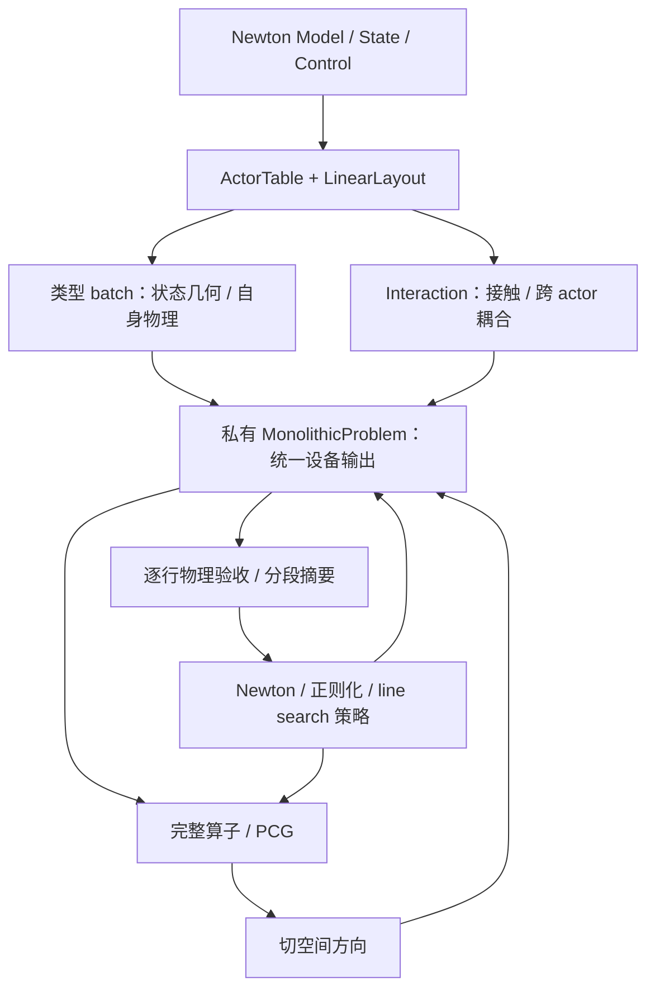

# PR-01：以 actor 为自由度所有者的统一非线性求解接口

2026-11-02。状态：**COMPLETE（接口与正确性验收）**；`P9a-PERF-01` 性能退化保持 OPEN。起点 `8fa80ba7`；这是用户指定的首个实现 PR。需求以 [PRD](PRD.md) 为准，参考来源见 [references](references.md)。

## 1. 交付物与边界

交付一个私有 `_MonolithicProblem` 和一份设备执行计划，供唯一的 Newton/line-search 策略使用。ActorTable 决定状态与自由度归属；类型 batch 实现状态几何和自身物理；contact/interaction 添加耦合；线性层仍解完整系统。

最终覆盖当前支持的 articulation、rigid、tet、cloth、cable 与 contact 组合。不得保留“q+x 专用设备实现 + 通用 NumPy fallback”。无 tet、无 articulation、不同 actor 排列都是正常输入，缺失必需能力应显式报错。

本 PR 完成 M2/M3/M4、L4/L5 的必要设备迁移，以及 M5 的迭代内回读移除。H2 的稀疏布局哈希、M1 的进一步小 packet 融合、M5 最终诊断快照和 L1/L2/L3 的额外缓存优化分别记录，不把它们伪装成 H1 已消除的成本。

## 2. 数据流

策略看不到 actor 类型或 q/x 边界；几何操作不会被移到通用归约 kernel。actor ownership、物理贡献、预条件器块、两套收敛组和 world/island 域各有独立描述。

## 3. 内部里程碑

### 01A：冻结基线、贡献清单与 red tests

- 盘点每个 producer 的状态、E/r/B、absolute、domain、reaction、history 和 matrix-free 输出；标出 host 运算及生命周期。保存起点版本、配置、输入、已有门槛和 kernel/同步计数。
- 从已有 q+x、多树、rigid、material fixtures 建立最小可重复比较；不另跑完整机器人轨迹作调试基线。
- 加入针对行为的失败用例：混合组设备归约、缺少必需贡献/phase 拒绝、遗漏 rigid energy、非 q+x 实际位移、热路径完整向量回读、材料 trial 污染。不能仅断言类名存在或旧私有字段删除。
- 对数学上本来就正确的行为用独立 oracle 固定保护，不强求所有重构测试在旧版失败；明确哪些是新合同 red tests。

验收：requirements-to-test 表和基线收据完整，旧版的预期失败已解释；尚不标记 H1 修复。

### 01B：ownership 派生计划与最薄 problem

- 从 ActorTable/LinearLayout 生成唯一 owner map、typed batch offsets、线性组和物理 RowGroups；复用 `group_data` 编号语义，不再 `1+row_group`。
- 为连续与离散物理组建立 chunk/segment 归约计划；每行每项只访问有限次。空 group 的 sum=0/min=+inf 等中性值不能被当成有效失败或错误收敛，零自由度整体场景沿用现有拒绝/支持合同。
- 以当前 producer 为基础拆分 enqueue 与 collect，统一写入 outputs；初始化验证必需 phase 和每项贡献注册。引入 `_MonolithicProblem` 接口并让 iteration 调用它。
- 同一份问题定义供 CPU/CUDA、graph-off/on 使用；单树 q+x 先通过独立 E/r/B 和物理标准验证。

验收：分组与 snapshot/reduction 组件通过；阶段性迁移兼容可保留，但不作为最终入口。

### 01C：多树、刚体与无 tet 全链路

- energy registry 包含全部 rigid energy 和 absolute-energy，contact 只登记一次；无某类 actor 的 batch 安全为空。
- articulation/粒子 difference 读取配套 step increments；rigid 实现 COM 和左乘相对旋转 log。使用显式 row maps，不从 `i<nq` 猜类型。
- domain 写统一 flags，包括旋转边界；保留现有 epsilon/坐标尺度、刚体步长统计约定，不能一律除以 scale。
- 打通 accepted linearize → PCG direction → candidate → domain/E/r/difference → decision → accept/reject → publish；交叉接触块和投影完整。

验收：单树+tet、多树混合单位、多树+rigid+tet 接触、rigid-only/joint-only/tet-only、actor 排列、旋转边界和 rejected trial；移除 single-tree/no-rigid/has-tet 门槛但不绕过能力验证。

### 01D：cloth/cable 完整设备契约

- 拆分材料 block 中的设备提交和 host 收集；整条路径检查、frame/history 更新、固定行反力、控制冻结/finite 校验全部写预分配输出。
- gauge 的 Jacobian 零模判断、因子分段检查、净 torque 兼容性和 delta 投影迁设备；保留原严格比较与精度，不以新阈值掩盖归约变化。
- 接入 cable BSR + matrix-free product/absolute product；trial `build_tangent=False` 不能覆盖 accepted element matrices。
- 接触作用后的 raw reaction、theta torque 与最后输出 generation 统一；不以 free rows 的 residual 代替固定点反力。
- 构建/捕获可以逐 block 展开，稳态按类型/phase 提交 graph，不能在每次迭代中逐 block `.numpy()`。CPU/graph-off 也运行同一批提交逻辑。

验收：材料控制错误、fixed/gauge、空因子、接触 torque、路径越界、rejected trial/operator 保留、checkpoint continuation/失败回滚；两精度与有/无 graph。至此才满足 H1 的全类型覆盖。

### 01E：唯一入口、删除旧路径、PR 收尾

- 删除旧 `_evaluate_eager` 与硬编码 q+x evaluation 组合分支、`_device_iteration` 选择器及迭代中的 NumPy RHS/norm/dot/displacement；方法名可合并重用，但不可留下隐藏 fallback。
- 删除被新路径替代的物理实现、临时开关、scratch 和失效测试假设；保留独立数学 oracle、failure rollback、受支持 checkpoint/API 兼容测试。
- iteration 中不读取 material/rigid/tet-specific 字段，也不硬编码 global/q/x 名称；限值、posterior、step statistics 由 metadata/summary 提供。
- 最终残差诊断暂在发布边界按 M5 原接口保存，标注其字节；H2 哈希单列，仍需完整计入端到端成本。
- 执行 64 步混合 E2E、回读/存储增长审计、小 q+x、FP64/FP32 quick、pre-commit，更新指南与所需 changelog，再提交本 PR 的完成记录。

验收：所有合同项有结果，旧路径彻底删除；只有包装层而材料仍走 NumPy时判为未完成。

## 4. 文件责任与测试映射

| 文件/模块 | 计划职责 | 主要现有测试 |
| --- | --- | --- |
| `actors.py`、`linear_types.py`、`convergence.py`、`pcg_common.py` | ownership 派生与两套 group；尽量不改变现有公共表示 | solver_actor_layout、solver_convergence、linear_multitree |
| 新 `problem.py`、`producers.py` | 私有协调、贡献注册、typed phase；复用现有物理 kernel | solver_producers、solver_contracts；新增 solver_problem 功能测试 |
| `iteration.py`、`iteration_device.py` | 类型无关策略与通用分段归约；文件可收敛，避免再造第三条实现 | solver_reductions、solver_direction、solver_globalization、precision_oracle |
| `solver_monolithic.py` | 公共入口与事务适配；替换旧双路调度 | solver_coupled、multitree、state_api、publication、input_boundary、graph |
| `rigid.py`、材料 block/operator、contact producer 必要部分 | domain/difference/energy、path/gauge/reaction/control 的设备输出 | solver_rigid、actor_contacts、cable_operator/solver/linear、cloth_solver/linear、material_state |

测试实际名称以仓库 `test_monolithic_*.py` 为准，新增测试按功能命名。不要大规模重命名无关模块或测试。

## 5. 测量合同与退出检查

以固定 actor 数 1/2/4/8 的同类型扩展和代表性混合场景，固定 Newton/PCG/trial 工作量记录：

- 非线性完整行向量 D2H 为 0（明确排除单列的 H2 布局与最终 Stats）；无逐 actor host 同步。
- 两套 group 正确，scratch 随 N/chunks/groups 线性增长，不出现 G×N。
- 所有已启用物理贡献覆盖；接触恰好计一次；rigid energy、固定反力、cable element operator 均可独立核对。
- 64 步真实输入→state_out/Stats E2E 与 failure branches；图内不能分配项目长期 buffer。初始化和库内部临时 scratch 按既有所有权规则区分。
- PR 收尾的实际 source/import/config/input hashes 与结果绑定。无新的硬失败或 frozen gate 回退；Stopped/Converged 分开报告。

结构计数是硬目标，运行速度先测后报告；当前没有承诺未经测量的百分比。每个里程碑完成只写局部结果，01E 前不能把 PR-01 标为完成。

## 6. 实现记录

本节保留各批次当时的状态；最终验收与剩余项以第 7 节为准。

2026-11-02，01A/01B 的分组归约基础：

- `test_layout_group_norms` 在旧实现上按预期失败：混合 articulation/rigid/tet/cloth/cable 布局需要 10 组，设备结果只有 3 组。
- 新 `SegmentedReduction` 使用固定次序的 chunk/segment 两级归约；支持离散行、空组、NaN 传播。线性组使用 global 加不重叠分区，共 2N 个行索引，没有 G×N scratch。
- `test_monolithic_solver_reductions` CPU/CUDA 共 10 项通过，包含 FP32/FP64、CUDA graph 捕获和修改输入后的重放。该结果只证明归约基础；旧双路径和材料 host 收集尚未移除。
- 原始结果目录为工作区 `dev/monolithic/test/results/P9/P9a/PR-01/20261102-01A/`：`group-norms-red.log`、`reductions-cpu.log`、`reductions-cuda.log`。完整 PR 验收、小 q+x、quick 和混合 E2E 尚未运行，不以局部 PASS 替代。

01A 的单步基线已保存于同目录 `baseline.json` 及其哈希索引的 input/control/output/Stats 文件。q+x、不同树长的多树、rigid-only、混合材料共 8 个 CPU FP64/FP32 用例均成功。这是包含输入校验和首次初始化的机制基线，不是稳态同步次数或性能结果；例如 `numpy_calls` 含 validation、contact 布局和最终诊断，不能直接归因于 Newton 迭代。

当前贡献盘点（01B 正在迁移）：

| 类型 | 能量与残差来源 | 额外输出及保护合同 |
| --- | --- | --- |
| articulation batch | link/joint energy、完整 joint residual、absolute | 映射到各树行；关节增量和旋转域；惯性/驱动/限位/摩擦切线 |
| rigid batch | 所有 rigid energy、6 行 residual/absolute | COM 与左乘相对旋转 log；6×6 切线；速度恢复 |
| tet | parts、dynamic residual/absolute | inversion/nonfinite、min det F、投影失败、完整内部切线 |
| cloth blocks | shell energy + external work/inertia、free rows 与固定行 raw | 整条 trial 路径、projection flags、固定反力；无 theta |
| cable blocks | stretch/bend/twist + external work/inertia/torque、xyz/theta raw | matrix-free element/absolute product、frame/history、gauge、固定反力；trial 不覆盖 accepted tangent |
| contact interaction | pool energy + supplied absolute energy、共享行 residual | 每次求值只 begin/append/finish 一次；capacity/geometry flags、跨 actor 切线、完整 particle/theta reaction |

新增 `solver_problem` 合同测试已在旧路径确认两个 red：rigid-only 设备总能量 0 而独立能量 6；材料求值在 producer 之间回读 energy。统一 energy registry、device reaction 与各类型 difference/domain 已开始接入。仍需完成 gauge/control 迁移、策略元数据化和全部 PR 退出检查。

01B/01C 的统一求值与几何批次：

- `_MonolithicProblem` 绑定 producer 能量、absolute-energy、geometry flags 和完整 residual/raw 的 finite 检查；拒绝重复或缺失贡献。所有类型复用 producer 的设备计算，删除 `_evaluate_eager`、专用 q+x objective 拼接和旧 energy packet。
- articulation/粒子/材料 difference 读取准确 step increments；rigid difference 使用 COM 和左乘相对 quaternion log。各类型 domain 汇总为一次状态读取；cloth predictor fallback 改为设备条件执行。
- contact 的 pool lifecycle 只执行一次；共享残差与固定点/角度 reaction 在独立 additive graph 中合并，禁用 warmup，避免重复相加。
- `problem-batch-cpu.log`：35 项，32 PASS、3 CUDA-only SKIP。覆盖问题接口/两精度、归约、producer、cloth、cable operator（含 rejected-trial 矩阵保护）、材料接触/固定反力/回滚，以及小 q+x 与独立 E/r/B oracle。`problem-batch-receipt.json` 绑定运行时 HEAD、工作差异 hash 和 import 路径。pre-commit 全部通过。
- CUDA 问题接口运行仍进行中（`problem-cuda-only.log`），未宣称 PASS。CPU 首次 tet 编译曾较长，堆栈确认在 Warp `build_cpu`；其后 CPU 批次正常完成。
- 尚未完成：gauge、control 和 assembly 状态的设备归并；iteration 仍有临时 device selector 与 host 兼容分支。PR-01 继续保持 IN_PROGRESS，完整 D2H 合同及 PR 退出门槛尚未验收。

01D 的 gauge 与 binding 批次：

- `CableGauges` 在设备上检查严格 Jacobian 零模、正权重 contact factor 的分组和、净 torque 兼容性，并用分段 FP64 mean 保留既有方向投影语义。trial pins 和 accepted operator pins 使用独立缓冲区。
- `test_gauge_device` 在原 host 实现上按预期失败（回读 raw torque），设备实现通过；新增空/尾空/全空 factor、乱序行归属、trial 不改变 accepted pins 的覆盖。
- `gauge-cable-cpu.log`：51 项中 34 PASS、17 CUDA-only SKIP。`gauge-contact-cuda.log`：5 PASS（gauge CPU/CUDA、两精度与 material contact CUDA graph replay）。
- 既有 `test_pooled_output_rebind_cpu` 暴露 energy registry 固定旧 buffer 的回归；已改为固定贡献声明、动态解析 owner 字段，保持 shape 合同并依靠实际 buffer binding 使 graph 失效。`gauge-binding-cpu.log` 中 5 项通过；CUDA binding 检查仍在运行。
- 第一轮 `solver_problem` CUDA 4 项已 PASS（`problem-cuda-only.log`，含首次编译约 32 分钟）。这次运行跨越后续源码编辑，未保存起始 diff，因此只作局部机制证据，不能替代最终固定版本 CUDA 验收。
- 下一批仍需删除 iteration 的双路径及 actor 类型判断，完成 control/assembly 状态迁移，再运行固定版本完整 PR 合同测试和退出门槛。

01D/01E 的统一迭代批次（仍在验证，未完成 PR）：

- 删除 `_device_iteration` 选择器与非线性循环中的 NumPy 向量分支。`MonolithicProblem` 从 actor ownership、LinearLayout 与物理 RowGroups 派生统计和限值；策略不再判断 rigid/material/q+x 类型。保留 `iteration.measure` 作为已有数值跟踪工具的薄钩子，其唯一实现委托 problem。
- 同一分段归约同时提供全局 scaled RMS 与 rigid 分组的物理位移 RMS，不混淆两者。完整混合迭代禁止读取残差、方向、尺度、有效位移、材料 raw/absolute 和能量向量。
- 材料控制与刚体外力冻结迁到设备；固定 theta 的 torque 拒绝、finite 检查和原控制快照语义保留。装配失败标志由 problem 统一收集。owner 的 predict/evaluate/assemble/candidate/difference/domain/publish 使用统一 phase；contact reservation/generation 保留每调用一次的生命周期。
- `iteration-red.log` 证实旧混合迭代回读完整 residual；`iteration-basic-cpu.log` 中混合迭代（两精度）和归约 5 项 PASS。`step-inputs-red.log` 证实旧材料控制和刚体准备回读向量；`step-inputs-green.log` PASS，`step-inputs-cuda.log` 三项 PASS（两精度控制冻结、步长单位与混合 graph 迭代）。各批次版本见同名 receipt；后续 phase capture 改动另测，不冒充最终版本全量 PASS。
- 新增 64 步加载/持有/卸载用例，覆盖两棵不同规模树+rigid+tet 的接触、articulation+rigid+tet+cloth+两条 cable、rigid-only；第 32 步 checkpoint 后 32 步逐项对照，另注入 rejected-trial 和 publish failure。`composed-e2e-cpu-v2.log` 中两精度三组合均完成；该轮早于最后 phase capture 改动，当前版本组件批次正在重跑。
- CPU 固定一次 Newton 求值/装配/PCG（1 次迭代）/trial 的结构审计：FP32/FP64 下 cable 数 1/2/4/8 各测 3 次，均为 32 次摘要/布局读取，无被监控物理向量回读。行数 7/14/28/56；非线性归约 scratch 标量数 52/96/184/360，行索引为 2N。H2 的两次 `_layout_signature` 读取仍明确计入；此结果不代表性能资格，CUDA 与混合场景审计尚待完成。原始数据 `structural-cpu.json`。
- 录制和性能工具迁到 problem 的求值与 candidate 钩子，profiler 透传 additive graph 的 warmup 语义；hotspot 保存并恢复精确 step increments。`hotspot-increments.log` PASS，并验证修改增量会使回放对照失败。
- 验证基础设施记录：一次 /tmp runner 误导入 integration worktree，已保存为 `iteration-invalid-import-*` 并废弃结果；runner 现显式绑定 cwd 和断言 import。两个 CPU 长批次曾在定时栈打印时退出 139，结果未计为 PASS；关闭定时打印后单独 publication-hard 与 64 步 E2E 通过，原因尚未归结为求解器故障。
- 当前受影响组件、CUDA phase/binding/publication 检查仍在运行。小 q+x 当前版本的独立 oracle、CUDA 64 步 E2E、quick 两精度、最终 pre-commit 和最终源码绑定审查仍须完成；PR-01 保持 IN_PROGRESS。

01E 审查与验收推进：

- `unified-components-cpu.log` 共 159 项：138 PASS、18 CUDA-only SKIP、3 ERROR。错误为 precision Observer 的旧求值钩子和 profiler 未透传 `warmup`；修复后 `observer-green.log` 4 PASS，包含独立历史/能量/残差/线性 oracle，`tooling-current-cpu-v2.log` 20 PASS，覆盖录制、PCG、objective/assembly 回放与 profile。
- 工具审查另修复完整接触审计对已删除 `combine` 的导入、JSON PCG 分组 floor 恢复为 tuple，以及 snapshot 的精确 step increments。`contact-system-red.log` 保存导入失败，`contact-system-green.log` 5 PASS；审计仍独立于生产迭代，未把旧物理路径恢复到 solver。
- `boundaries-cpu.log` 共 26 项：14 PASS、10 CUDA-only SKIP、2 失败。一个 publication fixture 仍注入 host reference，已按设备合同更新；另一个是 contact identity 错误信息丢失，已在失败边界保留原 int32 flags，`safety-green.log` 2 PASS。未改变其大整数精度要求。
- `problem-phases-cuda-v2.log` 3 PASS（混合迭代、contact 重绑、发布）；`composed-e2e-cuda.log` PASS，实际包含 3 种组合 × 2 精度 × graph off/on 的 12 个 64 步用例，以及各自的 32 步续跑和失败分支。首次编译计入测试耗时，不作为稳态性能。
- 独立 Fit 审查结论 Fits，未发现第二套状态/线性 workspace 或不必要公开 API。Requirements/Standards 审查发现的 Observer、废弃 cable scratch、int32 错误详情和工具调用方已处理。进一步加固初始化合同：每种类型声明必需 energy 字段，拒绝重复/部分缺失；去掉基类必需 phase 的空实现，仅具体类型保留有物理理由的中性 phase。`capability-red.log` 的三个边界均先失败，`capability-green.log` 8 PASS。
- graph 生命周期检查复现了 tet assembly 输出替换后仍写旧指针的问题（`assembly-rebind-red.log`）；已将该输出加入 phase binding。CUDA 修复验证和最终已提交版本的 E2E/结构审计仍须收齐。
- CPU 固定工作量结构审计：1/2/4/8 cable 对应 N=7/14/28/56，线性组 3/5/9/17，归约 scratch 52/96/184/360 个 scalar，索引总数 2N。两精度每例均为 32 次读取，包含两次 H2 `_layout_signature`；完整物理向量回读为 0。混合 A/R/T/cloth/2 cable（N=39、10 组）同为 32 次读取、236 个 scratch scalar。详见 `structural-cpu.json`、`structural-mixed-cpu.json`；这是固定单次阶段计数，不是完整 Newton 轮或 step 的计时。

PR-01 仍为 IN_PROGRESS。最终 quick 两精度、CUDA 结构扩展、成对稳态样本及最终结果身份尚未关闭；H2/M1、M5 最终快照、L1/L2/L3 仍按后续 PR 处理。

## 7. 最终验收与剩余性能项

运行版本：`2220971595d36ea7bd5ffa52d219a340f7d83ef9`，solver 文件树 SHA-256 `dda3dde1962db7ed10cdae6bbaf7a4d93af843dacb9ae6d28c08369574bf18d2`。CPU/CUDA 最终 E2E 的运行前后 HEAD、diff 和 import 一致。结果目录：`dev/monolithic/test/results/P9/P9a/PR-01/20261102-01A/`。最终完成记录只修改文档，不将文档提交冒充已运行的代码版本。

| PRD 合同 | 证据 |
| --- | --- |
| owner、两套分组、空组及线性存储 | `test_layout_group_norms`、`test_segment_storage`、`test_reductions`、actor/material layout；`final-structural-*.json` |
| 必需 phase/能量注册、接触只计一次、rigid energy | `test_required_contributions`、`test_complete_energy`、`test_invalid_contributions`；capability red/green |
| 实际位移、原步长单位与 domain | `test_state_geometry`、`test_step_group_units`、`test_domain_boundary`；独立 SO(3) oracle |
| 控制冻结、gauge、反力与 accepted operator | `test_step_inputs`、cable gauge/operator、material contacts/state；step-inputs/gauge 的 red/green |
| 缓冲重绑与事务 | `test_assembly_result_rebinding`、contact rebind、publication/safety、`test_composed_continuation` |
| 同一全类型设备迭代、无完整物理向量回读 | `test_mixed_iteration_payloads`、`test_owner_evaluation_stays_on_device`；CPU/CUDA 扩展及混合结构审计 |
| 小型组合 E2E | `final-e2e-cpu-receipt.json`、`final-e2e-cuda-receipt.json`：CPU 6、CUDA 12 个组合/精度/graph 用例，各 64 步及 32 步续跑、失败分支 |
| PR quick | `../quick-20261102-01/result.json`：COMPLETE/CLEAN，60 PASS；两精度窗口和两个小 tet cantilever，FP64 remote-tree 2000/2000 |
| 工具兼容与独立审查 | tooling-current-cpu-v2 20 PASS、Observer/contact-system/hotspot 检查；Fit/Requirements/Standards 发现均有修复或明确后续归属 |

固定阶段结构审计包含一次求值、装配、assessment、PCG（1 次迭代）和 trial，排除输入校验及最终 Stats；每例预热 2 次、采样 3 次。FP32/FP64 下，cable 数 1/2/4/8 对应 N=7/14/28/56，线性组 3/5/9/17，归约 scratch 52/96/184/360 个 scalar，索引 2N。含能量/gauge/status 的摘要 scratch，FP32 为 516/948/1812/3548 bytes，FP64 为 924/1700/3252/6372 bytes；没有 G×N 存储。

上述非线性阶段内完整物理向量回读全部为 0。CPU 每例 32 次读取；CUDA 每例 31 次读取、24 次 graph replay。CUDA FP32 读取字节 588/776/1152/1904，FP64 784/1092/1708/2940；包括明确保留的 H2 两次布局读取（56/108/212/420 bytes）。混合 A/R/T/cloth/2 cable 的 N=39、10 组，CUDA 同为 31 次读取、24 次 replay，读取字节 FP32 2212、FP64 2788。

额外 kernel 提交并非全部常数：CUDA 同类型扩展为 35/39/47/63 次。增加的每 cable 4 次来自现有 material absolute operator（assessment 3 次）和 cable preconditioner（linear 1 次）；它们始终在设备执行，没有逐 cable host 同步。该剩余提交成本归 PR-04 的材料批处理收尾，不宣称其成本目标已关闭。

本 PR 的关闭状态：H1/L4/L5 已实现并验证；M2/M3/M4 的设备迁移完成，额外批处理成本保持 OPEN；M5 只关闭迭代内回读。H2/R1、M1、M5 最终快照、L1/L2/L3 和阶段 suite/stage 不由本 PR 关闭。

`assembly-rebind-green` 的 3 项 CUDA 检查通过；该轮跨越本地提交，起始为 `0080fd39` 加工作差异、结束为 `22209715`，但前后 solver 文件树 hash 相同。它作为同一实现的机制证据，未被误标为单一 HEAD 的收据。先前跨源码或误导入的运行仍按第 6 节保留原始状态。

### 成对稳态测量

旧版 `8fa80ba7` 与新版 `22209715`，同一 RTX 5070 Ti Laptop GPU、Warp 1.17.0、driver 570.211.01，串行顺序为旧→新、新→旧、旧→新。每类每进程预热 4 次、计时 5 次，合计每版本 15 个样本；每次恢复同一初始 state/control。所有输入/配置 hash、Newton/PCG/trial 次数一致；两个 worktree 在运行前后均无差异。计时包含入口校验、H2 和最终 Stats，排除状态恢复及编译。下表为合并样本 median/P95（ms）；这些小 fixture 不构成 RL 吞吐资格。

| 场景 | 精度 | 旧版 median/P95 | 新版 median/P95 | median 变化 | Newton/PCG/trial |
| --- | --- | --- | --- | --- | --- |
| qx | fp32 | 31.888/33.429 | 34.401/35.278 | +7.9% | 3/30/3 |
| trees | fp32 | 38.263/41.148 | 38.934/41.535 | +1.8% | 5/15/5 |
| materials | fp32 | 32.920/33.541 | 21.282/22.328 | -35.4% | 1/1/1 |
| rigid | fp32 | 11.906/12.531 | 13.549/15.153 | +13.8% | 1/1/1 |
| qx | fp64 | 42.677/44.042 | 44.709/45.877 | +4.8% | 3/30/3 |
| trees | fp64 | 60.676/62.020 | 61.706/63.258 | +1.7% | 6/18/6 |
| materials | fp64 | 60.871/64.086 | 44.108/45.329 | -27.5% | 2/6/2 |
| rigid | fp64 | 11.353/11.853 | 12.422/13.763 | +9.4% | 1/1/1 |

原始数据与计数：`paired-{1,2,3}-{base,current}.json`、`paired-series.json`、`paired-summary.json`；复现脚本 `paired-step.py`、`paired-series.py`、`summarize-pairs.py` 同目录保存。D2H 记录的是 `array.numpy()` 调用及请求 payload 字节（包括空数组调用），不等同于 CUDA 同步指令的精确计数；H2D 记录 CPU→CUDA copy 的源 payload。计数来自单独的 instrumented step，未污染计时样本。首轮计数钩子曾因 `src=` 关键字不兼容中断，保留为 `invalid-copy-*`，未纳入对照。

- 混合材料 FP32：读取 320→148 次、12256→6204 bytes；H2D 27→5 次、3920→2876 bytes。FP64：读取 445→184 次、32872→13944 bytes；H2D 37→6 次、6108→2916 bytes。
- q+x 两精度的完整 step 读取 159→165 次，graph 提交 83→109；rigid-only 读取 121→114 次、graph 提交 33→57。完整 step 数字包含本 PR 明确保留的校验/H2/发布，不能与前面的固定阶段计数混用。
- 本次 `_graphs` 缓存的总驻留图：旧版 10–22，新版 36–43；所有样本 eviction 为 0，capture 总数等于驻留数。该计数只覆盖 solver segment cache，contact/PCG 自有图的实际 replay 包含在提交计数中，不据此声称所有 GPU 内存已归因或 L3 已关闭。

**`P9a-PERF-01`：OPEN。** q+x、rigid-only 三组成对中位耗时均退化（各组比例见 `paired-summary.json`）；多树变化约 2%，混合材料改善约 27%–35%。工作量一致，因此不是更少 Newton/PCG/trial 换来的差异。额外摘要与 graph/binding 工作是已观测到的成本变化，但尚未完成其耗时归因。按 PRD 允许的明确留项规则，本 PR 关闭统一接口与回读合同，**不宣称整体性能 PASS**；PR-03（M1）和 PR-06（L1/图绑定）须复用这组输入复测、定位并处理稳定退化，阶段性能资格保持 OPEN。

### 审查与结束条件

Fit、Requirements、Standards 三个视角的审查完成；发现的注册缺口、旧工具调用方、int32 错误详情、输出重绑和废弃 scratch 均已处理。物理门槛、快照、默认预算和公开配置未修改。pre-commit（含最终文档）与 Towncrier preview 已通过。没有运行阶段全量 suite/nightly，没有推送或合并。PR-02 仍是下一项计划，未在本 PR 顺带实施。

## 8. 机器人 FP32 补充对照

用户指定的四个现有冻结窗口、三组成对测量已完成，详见 [机器人性能对照](PR-01-robot-performance.md)。baseline `8fa80ba7`，新版 `7f20e48b`（solver 同 `22209715`）；全部原物理门槛通过，逐步求解工作量完全一致。Franka 两窗口总 solver 时间中位数退化 5.10%，Sharpa 退化 11.36%；其中 Sharpa close 退化 14.89%。

新增证据：新版 Sharpa close/lift 测量期间每轮捕获 2055/233 次，baseline 为 0，反复淘汰集中于含 alpha 参数键的 `problem_candidate`。`P9a-PERF-01` 的范围扩展到这些机器人窗口；PR-06 的数值参数/绑定和有限缓存处理须覆盖它。未修改 solver 或冻结门槛。
